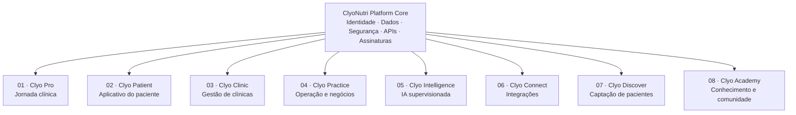
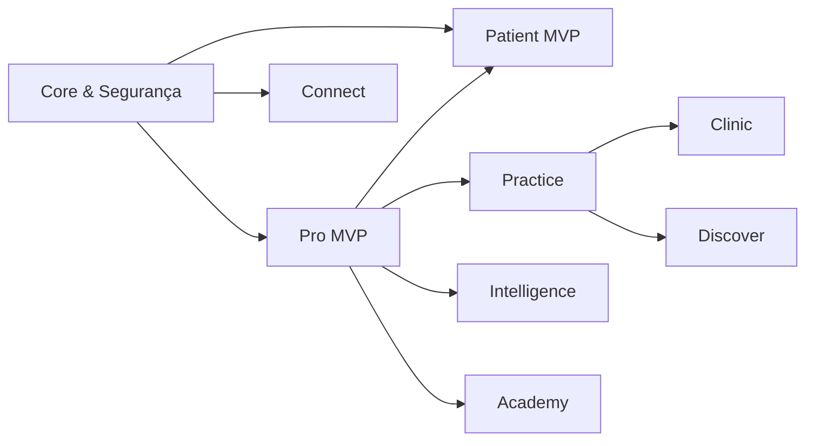

# ClyoNutri II — Mapa do Ecossistema e Estratégia de Produto 2026–2030

**Versão:** 1.0  
**Data:** 07/10/2026  
**Status:** Proposta estratégica para validação  
**Projeto Jira:** NI2 — https://caplybr.atlassian.net/jira/software/projects/NI2/boards/142

> **Visão:** tornar o ClyoNutri o sistema operacional do nutricionista brasileiro, unificando prática clínica, experiência do paciente, gestão do consultório e crescimento do negócio.

## 1. Ambição e definição de mercado

**Objetivo aspiracional:** alcançar pelo menos **20% de participação até 2030** no mercado brasileiro de softwares especializados utilizados por nutricionistas ativos pagantes.

**Importante:** a meta não é uma previsão. O denominador do mercado, a base de clientes pagantes dos concorrentes, a adoção de software e o tamanho do mercado endereçável ainda precisam ser pesquisados e validados. Acompanharemos também a participação em receita recorrente. Nutricionistas registrados não equivalem automaticamente a compradores de software.

### North Star Metric

**Profissionais nutricionistas pagantes e ativos mensalmente**, únicos, sem dupla contagem de profissionais vinculados a múltiplas clínicas.

### Mercado-alvo inicial

- Nutricionistas clínicos autônomos que atendem regularmente.
- Em seguida: pequenos consultórios e clínicas multiprofissionais com nutricionistas.
- Expansões futuras: redes, múltiplas unidades, atuação corporativa e parcerias educacionais.

## 2. Mapa de arquitetura do ecossistema



**Diretriz técnica:** oito domínios de negócio **não** significam oito aplicações de backend independentes. Proposta inicial: monólito modular Laravel, APIs versionadas e aplicativos web/mobile conectados, com isolamento multitenant e fronteiras de domínio explícitas.

## 3. Taxonomia de prioridades

- **P0 — Essencial:** requisito para jornada clínica e operação mínima confiável.
- **P1 — Diferenciação:** aumenta competitividade, adoção, eficiência e retenção.
- **P2 — Expansão:** viabiliza escala, novos segmentos ou novas receitas.

Prioridades iniciais e sujeitas a descoberta com clientes, esforço técnico e requisitos regulatórios.

## 4. Mapa detalhado de funcionalidades

### 4.1. Clyo Pro — Sistema do nutricionista

| Funcionalidade | Prioridade |
|---|---|
| Cadastro profissional, validação de CRN e onboarding | P0 |
| Dashboard clínico e agenda de trabalho | P0 |
| Cadastro, prontuário e histórico do paciente | P0 |
| Anamnese e questionários personalizáveis | P0 |
| Avaliação antropométrica e composição corporal | P0 |
| Banco de alimentos, medidas caseiras e receitas | P0 |
| Cálculos nutricionais, necessidades energéticas e referências aplicáveis | P0 |
| Prescrição alimentar por alimentos, equivalentes e qualitativa | P0 |
| Substituições com equivalência nutricional | P0 |
| Exames laboratoriais, anexos e histórico | P0 |
| Documentos, orientações e relatórios clínicos | P0 |
| Protocolos por especialidade e modelos reutilizáveis | P1 |
| Registro por voz com revisão profissional | P1 |
| Prescrição avançada de suplementos, dentro do escopo legal | P1 |
| Avaliações específicas materno-infantis e esportivas | P1 |
| Importação estruturada de prontuários de concorrentes | P1 |

**Resultado esperado:** nutricionista consegue concluir uma consulta e publicar um plano de qualidade com segurança e mínimo atrito.

### 4.2. Clyo Patient — Aplicativo do paciente

| Funcionalidade | Prioridade |
|---|---|
| Convite, cadastro e onboarding simplificado | P0 |
| Plano alimentar organizado por refeições | P0 |
| Lista de substituições autorizadas | P0 |
| Agenda, consultas e lembretes | P0 |
| Diário alimentar com fotos e observações | P0 |
| Registro de peso, água e evolução | P0 |
| Metas e orientações do nutricionista | P0 |
| Chat seguro profissional-paciente | P1 |
| Lista de compras gerada pelo plano | P1 |
| Receitas e orientações práticas | P1 |
| Check-in semanal de adesão e dificuldades | P1 |
| Registro de sintomas, sono e hábitos | P1 |
| Apple Health / Health Connect, mediante autorização | P1 |
| Modo família ou cuidador com permissões | P2 |
| Consulta offline do plano | P2 |

**Resultado esperado:** paciente entende e consegue seguir o plano fora do consultório, com acompanhamento e privacidade.

### 4.3. Clyo Clinic — Clínicas e equipes

| Funcionalidade | Prioridade |
|---|---|
| Organizações, unidades e equipe | P1 |
| Papéis de nutricionista, gestor e recepção | P1 |
| Agenda de vários profissionais e salas | P1 |
| Gestão de serviços e pacotes | P1 |
| Permissões por função e paciente | P1 |
| Repasse e comissionamento de profissionais | P1 |
| Indicadores clínicos e operacionais por unidade | P1 |
| Marca, identidade e documentos da clínica | P1 |
| Filiais, centros de custo e consolidação | P2 |
| Gestão de contratos corporativos | P2 |

**Resultado esperado:** clínica opera múltiplos profissionais com governança de dados e gestão centralizada.

### 4.4. Clyo Practice — Gestão e crescimento do consultório

| Funcionalidade | Prioridade |
|---|---|
| Agendamento público, disponibilidade e confirmação | P0 |
| Cadastro de serviços e tabela de preços | P0 |
| Controle de recebimentos e pagamentos | P0 |
| Cobranças por Pix e cartão via provedor | P1 |
| Recibos e documentos fiscais conforme regras e integrações aplicáveis | P1 |
| Políticas de cancelamento e reagendamento | P1 |
| Controle de pacotes de acompanhamento | P1 |
| Indicadores de faturamento e inadimplência | P1 |
| CRM de contatos e potenciais pacientes | P1 |
| Automação de retornos e reativação de pacientes | P1 |
| Análise de retenção, ocupação e receita | P1 |
| Assinatura recorrente de acompanhamento | P2 |

**Resultado esperado:** profissional administra a prática de ponta a ponta, com controle financeiro e comercial.

### 4.5. Clyo Intelligence — IA e automações com supervisão

| Funcionalidade | Prioridade |
|---|---|
| Resumo de anamnese e histórico com fontes identificáveis | P1 |
| Rascunho de plano alimentar com validação nutricional | P1 |
| Sugestões de substituição sujeitas a aprovação | P1 |
| Análise de pendências e alertas clínicos | P1 |
| Transcrição de consulta com consentimento | P1 |
| Assistente para redigir orientações e materiais | P1 |
| Busca inteligente em prontuários autorizados | P1 |
| Sugestão de mensagens de acompanhamento | P1 |
| Indicadores de pacientes com menor engajamento | P2 |
| Análise agregada de padrões e resultados | P2 |

**Governança:** IA não prescreve autonomamente; recomendações e conteúdos clínicos devem ser revisados e aprovados por profissional habilitado. Exigir consentimento e base legal adequada, logs, avaliação de riscos, minimização de dados e controle de custos.

### 4.6. Clyo Connect — Interoperabilidade

| Funcionalidade | Prioridade |
|---|---|
| E-mails transacionais e notificações | P0 |
| API e webhooks autenticados | P1 |
| WhatsApp oficial com consentimento e templates | P1 |
| Google/Microsoft Calendar | P1 |
| Provedor de pagamentos Pix/cartão | P1 |
| Vídeo para teleconsulta | P1 |
| Health Connect / Apple Health | P1 |
| Importação e exportação estruturada | P1 |
| Laboratórios parceiros | P2 |
| FHIR, quando aplicável e viável | P2 |

**Resultado esperado:** reduzir trabalho manual e interoperar sem dependência excessiva de fornecedores.

### 4.7. Clyo Discover — Captação de pacientes

| Funcionalidade | Prioridade |
|---|---|
| Página pública profissional responsiva | P1 |
| Perfil com credenciais verificadas | P1 |
| Link de agendamento e disponibilidade | P1 |
| SEO local e dados estruturados | P1 |
| Landing personalizada do profissional | P1 |
| Mensuração de visitas, contatos e agendamentos | P1 |
| Diretório de profissionais com filtros | P2 |
| Avaliações verificadas e moderadas | P2 |
| Campanhas e programa de indicação | P2 |
| Marketplace com critérios transparentes | P2 |

**Resultado esperado:** plataforma ajuda profissional a ser encontrado, sem promessas clínicas indevidas ou publicidade irregular.

### 4.8. Clyo Academy — Educação e comunidade

| Funcionalidade | Prioridade |
|---|---|
| Central de ajuda e onboarding guiado | P0 |
| Base de conhecimento clínico referenciada | P1 |
| Templates de consultas e protocolos | P1 |
| Comunidade profissional moderada | P2 |
| Webinars e trilhas de atualização | P2 |
| Cursos e certificados de participação | P2 |
| Programa de embaixadores e indicação | P2 |
| Conteúdo para estudantes de nutrição | P2 |

**Resultado esperado:** facilitar adoção, desenvolver comunidade e fortalecer a marca.

## 5. Seis diferenciais competitivos centrais

1. **UX/UI premium e objetiva:** navegação consistente, acessibilidade, poucas etapas e domínio de tarefas clínicas.
2. **Prescrição alimentar superior:** editor responsivo, cálculos rastreáveis, substituições coerentes, modelos e validações.
3. **Aplicativo realmente útil para pacientes:** plano claro, adesão sem fricção e acompanhamento prático.
4. **Migração segura:** importação autorizada de arquivos e exportações, com prévia, validação, trilha e tratamento de erros.
5. **Crescimento do consultório:** agendamento público, cobrança, relacionamento, página profissional e gestão de desempenho.
6. **Confiança e portabilidade:** segurança, exportação, transparência de preços, suporte, disponibilidade e governança.

**Hipótese central:** competir por experiência clínica e resultados operacionais, não apenas por quantidade de funcionalidades.

## 6. Estratégia de distribuição e participação de mercado

### 6.1. Segmentação de entrada

- **Beachhead:** nutricionistas autônomos que atendem em consultório e precisam de prescrição + acompanhamento do paciente.
- **Expansão próxima:** pequenos grupos e clínicas especializadas.
- **Expansão tardia:** redes e organizações com necessidades multiunidade.

### 6.2. Canais a validar

- Aquisição orgânica via conteúdo e SEO orientado a profissionais.
- Programa de indicação profissional.
- Parcerias com instituições de ensino e comunidades de nutricionistas.
- Migração assistida de sistemas concorrentes usando exportações autorizadas.
- Vendas consultivas para clínicas e pequenos grupos.
- Programa de embaixadores, após comprovação de retenção.

### 6.3. Fórmulas de acompanhamento

```text
Market Share (profissionais) = profissionais pagantes ativos únicos ClyoNutri /
                               profissionais pagantes ativos únicos no mercado-alvo

MRR bruto teórico = profissionais pagantes × receita média mensal por profissional
ARR anualizado    = MRR × 12

LTV/CAC e payback devem ser calculados com margem bruta,
churn real, custos comerciais e receita observada.
```

### 6.4. Cenário hipotético (não é estimativa de mercado)

| Variável | Cenário ilustrativo |
|---|---:|
| Profissionais ativos pagantes no mercado-alvo | 100.000 |
| Meta de participação | 20% |
| Profissionais pagantes no ClyoNutri | 20.000 |
| Receita média mensal por profissional | R$ 99 |
| MRR bruto teórico | R$ 1.980.000 |
| ARR anualizado bruto teórico | R$ 23.760.000 |

Valores excluem descontos, churn, custos, tributos e inadimplência; uma hipótese estratégica deve ser confrontada com dados de mercado e pesquisa primária.

## 7. Roadmap 2026–2030

| Fase | Janela indicativa | Entregas principais | Gate de passagem |
|---|---|---|---|
| **F1 — Fundação e MVP clínico** | 0–6 meses | Pro P0, Patient P0, identidade, prontuário, prescrição, agenda, segurança | Jornadas clínicas concluídas, testes de segurança e primeiros clientes ativos |
| **F2 — Competitividade e retenção** | 6–12 meses | Chat, diário, modelos, cobrança, migração, relatórios e integrações essenciais | Retenção de coortes e ativação comprovadas |
| **F3 — Diferenciação e crescimento** | 12–24 meses | IA supervisionada, Clinic, CRM, páginas profissionais e gestão avançada | Economia unitária e canais de aquisição repetíveis |
| **F4 — Escala e liderança** | 24–48 meses | Marketplace, multiunidade, APIs e parceiros, Academy | Crescimento sustentável e progresso verificável rumo à meta de share |

**Nota:** todas as janelas são hipóteses de planejamento dependentes de equipe, orçamento, complexidade e testes de mercado. Para uma meta até 2030, acompanhar trimestralmente a distância entre a participação alcançada e o objetivo.

## 8. Métricas estratégicas e de produto

| Indicador | Meta inicial proposta | Observação |
|---|---:|---|
| Primeiro plano publicado em até 7 dias após cadastro | ≥ 70% | Ativação |
| Retenção de profissionais pagantes em 12 meses | ≥ 85% | Medir por coorte |
| Disponibilidade mensal | ≥ 99,9% | SLA e telemetria |
| CSAT de suporte | ≥ 90% | Pesquisa após resolução |
| CAC payback | ≤ 12 meses | Usar margem de contribuição |
| LTV/CAC | ≥ 3 | Com dados reais |
| Uso semanal do app por pacientes convidados | ≥ 50% | Definição rigorosa de atividade |
| Share no mercado-alvo | ≥ 20% até 2030 | Exige mensuração externa validada |

**Indicadores complementares:** tempo mediano de prescrição; taxa de erro e retrabalho; adoção de funcionalidades; saúde das coortes; NPS; churn bruto e líquido; receita por conta; custo de infraestrutura por usuário; incidentes de segurança; reclamações; time-to-value; conversão de teste para pago; taxas de sucesso de importação.

## 9. Design System Premium — Diretriz unificadora

Todos os produtos devem seguir a mesma linguagem de marca, adaptada às necessidades de desktop e mobile.

| Token | Referência |
|---|---|
| Azul-marinho principal | `#0F2747` |
| Cobre/laranja de ação | `#E67A3F` |
| Branco quente | `#FAF7F2` |
| Branco | `#FFFFFF` |
| Tipografia editorial na landing | Playfair Display |
| Tipografia funcional no sistema | Inter |

**Princípios:** hierarquia tipográfica, muito espaço em branco, contraste forte, componentes consistentes, acessibilidade, navegação rápida e mínimo ruído visual. Landing mais emocional/editorial; produto mais utilitário. Não usar estética pastel/verde tradicional como identidade predominante.

## 10. Segurança, privacidade, clínica e compliance

Itens transversais **desde a F1**, independentemente da prioridade comercial do módulo:

- Governança LGPD com tratamento adequado de dados pessoais sensíveis de saúde, base legal, transparência e direitos dos titulares.
- Confirmação de credenciais profissionais e situação no CRN por meios autorizados; políticas de bloqueio e revisão.
- RBAC e autorização por entidade/tenant/paciente, isolamento multitenant, prevenção de IDOR e testes automatizados.
- Criptografia em trânsito e repouso onde aplicável, gestão de segredos, MFA para funções críticas e trilhas imutáveis ou resistentes à adulteração.
- Backups, testes periódicos de restauração, objetivos de recuperação, resposta a incidentes e monitoramento.
- Integridade, versionamento, autoria, consentimentos, registros e política de retenção do prontuário conforme regras aplicáveis.
- Regras vigentes sobre teleatendimento, publicidade, documentação, nutrição e exercício profissional.
- Proteção de fotos corporais, medições, exames e dados de menores; controles para acesso por cuidadores.
- IA sob supervisão profissional, validação de fontes e resultados, controle de acesso, rastreabilidade e prevenção de uso secundário indevido.
- Revisão jurídica/regulatória antes de go-live e sempre que o escopo clínico ou o tratamento de dados mudar.

## 11. Estratégia técnica recomendada

### Modelo inicial

- **Backend:** Laravel, monólito modular com separação de domínios.
- **Persistência:** banco relacional com migrations, integridade referencial, auditoria e estratégia multitenant explícita.
- **API:** contratos REST versionados, autenticação, rate limit, validação e políticas de autorização.
- **Web:** frontend responsivo, componentes do Design System, estados de erro e acessibilidade.
- **Mobile:** aplicativo para paciente consumindo APIs da plataforma; experiência offline evolutiva.
- **Infra:** filas para tarefas assíncronas, logs estruturados, métricas, monitoramento, testes CI/CD, backups e secrets management.
- **Integrações:** adapters isolados, idempotência, retries seguros e observabilidade de falhas.

**Trade-off:** evitar microsserviços prematuros; extrair serviços apenas quando fronteiras operacionais, carga e autonomia de equipes justificarem o custo.

## 12. Portfólio inicial de épicos para NI2

| Código de planejamento* | Épico estratégico | Escopo |
|---|---|---|
| NI2-EP01 | Clyo Core & Identity | autenticação, organizações, perfil, segurança, assinaturas e dados |
| NI2-EP02 | Clyo Pro — Jornada Clínica | paciente, anamnese, avaliação, prescrição, documentos |
| NI2-EP03 | Clyo Patient — App do Paciente | onboarding, plano, diário, agenda, evolução |
| NI2-EP04 | Clyo Clinic — Gestão de Equipes | organizações multi-profissional, acesso, salas, repasses |
| NI2-EP05 | Clyo Practice — Gestão de Negócio | agenda pública, cobrança, CRM, pacotes e indicadores |
| NI2-EP06 | Clyo Intelligence — IA Assistiva | resumos, sugestões supervisionadas e automações |
| NI2-EP07 | Clyo Connect — Integrações | webhooks, calendário, pagamentos, mensageria, dados |
| NI2-EP08 | Clyo Discover — Aquisição | perfis públicos, agendamento, SEO, indicação |
| NI2-EP09 | Clyo Academy — Conhecimento | ajuda, conteúdo, comunidade, educação |
| NI2-EP10 | Design System Premium & Acessibilidade | tokens, componentes, padrões de interface e UX |
| NI2-EP11 | Trust, LGPD & Segurança | privacidade, auditoria, tenant isolation e recuperação |
| NI2-EP12 | Go-to-Market, Analytics & Growth | funil, coortes, experimentos, canais e share |

\* Códigos `NI2-EPxx` são **identificadores de planejamento**, não números de issues existentes ou criadas no Jira.

### Dependências principais



## 13. Critérios de decisão e riscos

### Gates de produto

1. **Problema validado:** entrevistas, observação de consultas e comparação competitiva.
2. **MVP útil:** nutricionista conclui atendimento e entrega plano ao paciente.
3. **Confiabilidade:** testes clínicos, segurança e prontuário aprovado em revisão especializada.
4. **Ativação:** clientes chegam ao primeiro valor rapidamente, sem assistência manual excessiva.
5. **Retenção:** profissionais renovam e pacientes mantêm uso relevante.
6. **Escala:** canais de aquisição sustentáveis, suporte e infraestrutura suportam crescimento.

### Riscos principais

- Expansão excessiva de escopo antes de atingir product-market fit.
- Bases de alimentos e algoritmos nutricionais com problemas de qualidade ou licenciamento.
- Interface bonita, porém lenta ou incapaz de suportar uma consulta real.
- Alto CAC, churn elevado e dificuldade de migração dos concorrentes.
- Incidentes de privacidade, vazamento de dados ou acesso cruzado entre clínicas.
- Uso indevido de IA para sugestões clínicas sem revisão profissional.
- Complexidade operacional de pagamento, fiscalidade e integrações externas.
- Interpretação equivocada da métrica de 20% sem denominador auditável.

## 14. Próximas ações

1. Validar o mercado-alvo, o denominador de share e as premissas financeiras com pesquisa externa e entrevistas.
2. Conduzir benchmark aprofundado de Dietbox, WebDiet, Nutrium, DietSystem e alternativas relevantes, testando jornadas concretas.
3. Desenhar protótipos de **consulta completa**, **prescrição** e **app do paciente** com o Design System Premium.
4. Criar TRD, modelo de dados inicial e matriz de segurança e isolamento de tenant.
5. Converter os épicos de planejamento em histórias com critérios de aceite, casos de erro, testes, dependências e estimativas.
6. Entregar F1 para um grupo piloto e medir ativação, velocidade de atendimento, qualidade clínica e retenção.

---

**Decisão orientadora:** vencer por experiência clínica, adesão do paciente e confiança — não por multiplicar telas. A meta de 20% exige excelência de produto **e** uma máquina de distribuição financeiramente sustentável.
