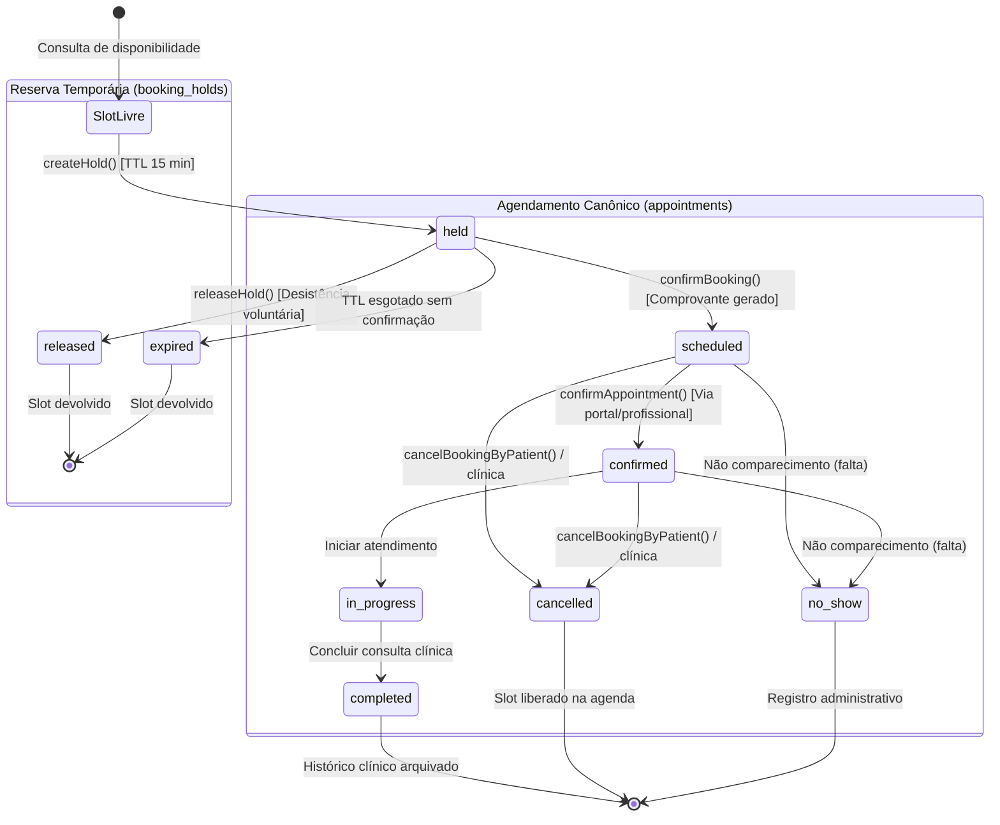

# ClyoNutri II — Arquitetura e Contrato de Estados do Autoagendamento Self-Service (NI2-433 / NI2-434)

## 1. Visão Geral e Princípios Arquiteturais

O sistema de autoagendamento self-service da ClyoNutri permite que pacientes novos e existentes consultem disponibilidade real e realizem reservas sem intervenção manual, garantindo:
1. **Unicidade e Integridade do Domínio de Agenda:** Não existe "agenda paralela". Toda reserva confirmada converte-se atomicamente em um registro canônico na tabela `appointments` com trilha auditável em `appointment_status_history`.
2. **Separação Estrita de Estados:** O ciclo de vida da reserva temporária (*Hold*) não se confunde com o ciclo de vida clínico da consulta (*Appointment*), nem com os estados de faturamento/pagamento ou de teleconsulta.
3. **Proteção Transacional Anti-Overbooking:** Reservas temporárias (*Holds*) e agendamentos canônicos disputam o mesmo recurso temporal em transações ACID, impedindo reservas duplicadas sob concorrência intensa.
4. **Reserva Temporária com TTL (Time-To-Live):** O paciente retém um slot exclusivamente por 15 minutos (`held`). Se não concluir o preenchimento ou desistir, o slot expira automaticamente (`expired`) ou é liberado de imediato (`released`).
5. **Idempotência Nativa:** Toda requisição de criação de hold suporta `idempotency_key` (chave única por clínica/sessão) para evitar duplicação em caso de retry ou duplo clique.
6. **Isolamento Multi-Tenant Estrito:** Todas as operações validam `clinic_id`, `professional_id` e `patient_id` com proteção em nível de banco de dados (`ON DELETE RESTRICT`).

---

## 2. Diagrama de Transição de Estados

---

## 3. Matrizes de Estados por Dimensão

### 3.1. Dimensão 1: Ciclo de Vida da Reserva Temporária (`booking_holds.status`)

| Estado | Significado | Próximos Estados Permitidos | Impacto no Slot |
| :--- | :--- | :--- | :--- |
| `held` | Horário reservado temporariamente pelo paciente com TTL ativo (15 min). | `converted`, `released`, `expired` | **Bloqueia o slot** para outros usuários. |
| `converted` | Paciente confirmou seus dados e o agendamento canônico foi persistido em `appointments`. | *Terminal* | Slot transferido para a consulta canônica. |
| `released` | Paciente desistiu voluntariamente antes do TTL expirar. | *Terminal* | **Libera o slot** imediatamente. |
| `expired` | TTL de 15 minutos decorreu sem confirmação. | *Terminal* | **Libera o slot** automaticamente. |

### 3.2. Dimensão 2: Ciclo Clínico da Consulta (`appointments.status`)

| Estado | Significado | Próximos Estados Permitidos |
| :--- | :--- | :--- |
| `scheduled` | Consulta agendada com data e horário definidos. | `confirmed`, `in_progress`, `cancelled`, `no_show` |
| `confirmed` | Consulta confirmada pelo paciente ou recepção. | `in_progress`, `cancelled`, `no_show` |
| `in_progress` | Consulta iniciada pelo nutricionista. | `completed`, `cancelled` |
| `completed` | Consulta concluída com anotações e condutas salvas. | *Terminal* |
| `cancelled` | Consulta cancelada (com motivo e trilha auditável). | *Terminal* |
| `no_show` | Paciente não compareceu ao atendimento. | *Terminal* |

### 3.3. Dimensão 3: Ciclo de Faturamento / Pagamento (`booking_holds.payment_status`)

| Estado | Descrição |
| :--- | :--- |
| `not_required` | A clínica não exige pagamento antecipado para agendar. |
| `pending` | Pagamento antecipado exigido; aguardando compensação Pix/Cartão. |
| `paid` | Pagamento aprovado pelo gateway de pagamento. |
| `waived` | Cobrança isenta ou bonificada pela clínica. |

### 3.4. Dimensão 4: Ciclo de Teleconsulta (`teleconsultation_sessions.status`)

| Estado | Descrição |
| :--- | :--- |
| `not_applicable` | Consulta na modalidade presencial no consultório. |
| `pending_admission` | Sessão criada; aguardando abertura da janela e admissão. |
| `waiting_room` | Paciente realizou teste de mídia e aguarda admissão na sala de espera. |
| `in_session` | Chamada WebRTC ativa com nutri e paciente conectados. |
| `ended` | Consulta remota encerrada pelo profissional. |

---

## 4. Tratamento de Erros e Códigos HTTP Padronizados

| Cenário | HTTP | Código da API |
| :--- | :---: | :--- |
| Profissional inexistente, inativo, de outra clínica ou com autoagendamento desligado (opt-in) | `404` | `BOOKING_NOT_AVAILABLE` (não diz qual) |
| Horário fora da jornada, na pausa, antes da antecedência mínima, além do limite futuro, fora da grade, ocupado ou em hold | `409` | `SLOT_UNAVAILABLE` (hold) / `SLOT_CONFLICT` (confirmação e remarcação) |
| Hold vencido, liberado ou já fechado sem consulta | `410` | `HOLD_EXPIRED` |
| Dados inválidos (formato de data, modalidade, tipo, e-mail, telefone, nome, termo não aceito ou de versão antiga) | `422` | `UNPROCESSABLE_ENTITY` / `INVALID_ARGUMENT` |
| Política da clínica (cancelar/remarcar com pouca antecedência, modalidade desligada) | `422` | `POLICY_VIOLATION` / `UNPROCESSABLE_ENTITY` |
| Consulta já cancelada/realizada, ou alterada durante a operação | `409` | `INVALID_STATE` |
| Paciente sem sessão do app | `401` | `UNAUTHENTICATED` |
| Paciente mexendo em consulta de outra pessoa ou clínica | `403` | `FORBIDDEN` |
| Muitas tentativas do mesmo IP | `429` | `RATE_LIMITED` |

---

## 5. Auditoria e Rastreabilidade

Todas as transições registram metadados estruturados em `appointment_status_history` e `audit_logs`:
- Timestamp UTC exato.
- IP de origem ou ID do usuário responsável (ou `patient_id` autenticado via portal).
- Estado anterior e estado posterior (`from_status` -> `to_status`).
- Motivo legível (ex: `"Autoagendamento self-service pelo paciente (portal/web)"`, `"Reagendado pelo paciente de DD/MM/AAAA para DD/MM/AAAA. Motivo: ..."`).
- Nenhuma informação clínica protegida (PHI/CID) é exposta em logs de agendamento.

---

## 6. Revisão de 20/10/2026 (implementação verificável)

- **Opt-in:** sem linha em `booking_settings`, o autoagendamento fica desligado. A clínica liga em Configurações → Agendamento online, e só owner/admin altera.
- **Entrada contextual:** `/agendar/{professionalId}` mostra só aquele profissional. `/agendar` sem id e profissional não apto respondem 404. Não há listagem entre clínicas.
- **Disponibilidade real:** só a jornada configurada em Configurações. Sem configuração, não há horários (antes era inventado seg–sex 8–18). Consultas `cancelled`/`no_show` liberam o horário, como na agenda interna.
- **O servidor decide:** a clínica vem do profissional, a duração vem do cadastro dele e o horário precisa ser um dos slots oferecidos.
- **Concorrência:** hold, confirmação e remarcação travam o profissional (`SELECT … FOR UPDATE` no MySQL, a mesma trava da agenda interna). A confirmação toma posse do hold por `UPDATE … WHERE status='held'`.
- **Identidade:** o paciente existente só é vinculado com e-mail **e** nome iguais; caso contrário, é criado um cadastro novo. O hold não guarda nome, e-mail, telefone nem CPF. O CPF não é coletado.
- **Consentimento:** a confirmação exige o aceite do termo `clinical_care` vigente e grava `patient_consents` com `term_id` e `source_channel = self_service_booking`.
- **Abuso:** limite por IP (hash), com slots 120, holds 10 e confirmações 20 a cada 10 minutos.
- **Auditoria:** `audit_logs` com `BOOKING_HOLD_CREATED`, `BOOKING_CONFIRMED`, `BOOKING_HOLD_EXPIRED`, `BOOKING_RESCHEDULED_BY_PATIENT`, `BOOKING_CANCELLED_BY_PATIENT` e `BOOKING_SETTINGS_UPDATED`, sem dados pessoais.

Evidências: `docs/evidencias/ni2-433/RELATORIO.md`.
