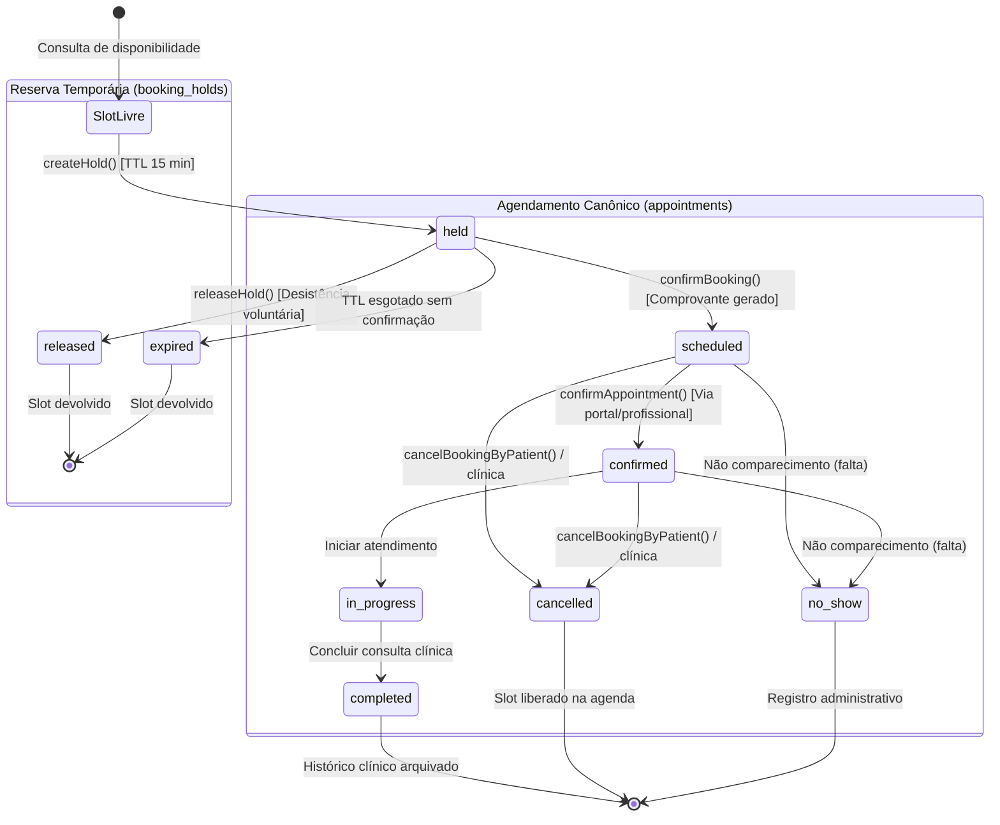

# ClyoNutri II — Arquitetura e Contrato de Estados do Autoagendamento Self-Service (NI2-433 / NI2-434)

## 1. Visão Geral e Princípios Arquiteturais

O sistema de autoagendamento self-service da ClyoNutri permite que pacientes novos e existentes consultem disponibilidade real e realizem reservas sem intervenção manual, garantindo:
1. **Unicidade e Integridade do Domínio de Agenda:** Não existe "agenda paralela". Toda reserva confirmada converte-se atomicamente em um registro canônico na tabela `appointments` com trilha auditável em `appointment_status_history`.
2. **Separação Estrita de Estados:** O ciclo de vida da reserva temporária (*Hold*) não se confunde com o ciclo de vida clínico da consulta (*Appointment*), nem com os estados de faturamento/pagamento ou de teleconsulta.
3. **Proteção Transacional Anti-Overbooking:** Reservas temporárias (*Holds*) e agendamentos canônicos disputam o mesmo recurso temporal em transações ACID, impedindo reservas duplicadas sob concorrência intensa.
4. **Reserva Temporária com TTL (Time-To-Live):** O paciente retém um slot exclusivamente por 15 minutos (`held`). Se não concluir o preenchimento ou desistir, o slot expira automaticamente (`expired`) ou é liberado de imediato (`released`).
5. **Idempotência Nativa:** Toda requisição de criação de hold suporta `idempotency_key` (chave única por clínica/sessão) para evitar duplicação em caso de retry ou duplo clique.
6. **Isolamento Multi-Tenant Estrito:** Todas as operações validam `clinic_id`, `professional_id` e `patient_id` com proteção em nível de banco de dados (`ON DELETE RESTRICT`).

---

## 2. Diagrama de Transição de Estados

---

## 3. Matrizes de Estados por Dimensão

### 3.1. Dimensão 1: Ciclo de Vida da Reserva Temporária (`booking_holds.status`)

| Estado | Significado | Próximos Estados Permitidos | Impacto no Slot |
| :--- | :--- | :--- | :--- |
| `held` | Horário reservado temporariamente pelo paciente com TTL ativo (15 min). | `converted`, `released`, `expired` | **Bloqueia o slot** para outros usuários. |
| `converted` | Paciente confirmou seus dados e o agendamento canônico foi persistido em `appointments`. | *Terminal* | Slot transferido para a consulta canônica. |
| `released` | Paciente desistiu voluntariamente antes do TTL expirar. | *Terminal* | **Libera o slot** imediatamente. |
| `expired` | TTL de 15 minutos decorreu sem confirmação. | *Terminal* | **Libera o slot** automaticamente. |

### 3.2. Dimensão 2: Ciclo Clínico da Consulta (`appointments.status`)

| Estado | Significado | Próximos Estados Permitidos |
| :--- | :--- | :--- |
| `scheduled` | Consulta agendada com data e horário definidos. | `confirmed`, `in_progress`, `cancelled`, `no_show` |
| `confirmed` | Consulta confirmada pelo paciente ou recepção. | `in_progress`, `cancelled`, `no_show` |
| `in_progress` | Consulta iniciada pelo nutricionista. | `completed`, `cancelled` |
| `completed` | Consulta concluída com anotações e condutas salvas. | *Terminal* |
| `cancelled` | Consulta cancelada (com motivo e trilha auditável). | *Terminal* |
| `no_show` | Paciente não compareceu ao atendimento. | *Terminal* |

### 3.3. Dimensão 3: Ciclo de Faturamento / Pagamento (`booking_holds.payment_status`)

| Estado | Descrição |
| :--- | :--- |
| `not_required` | A clínica não exige pagamento antecipado para agendar. |
| `pending` | Pagamento antecipado exigido; aguardando compensação Pix/Cartão. |
| `paid` | Pagamento aprovado pelo gateway de pagamento. |
| `waived` | Cobrança isenta ou bonificada pela clínica. |

### 3.4. Dimensão 4: Ciclo de Teleconsulta (`teleconsultation_sessions.status`)

| Estado | Descrição |
| :--- | :--- |
| `not_applicable` | Consulta na modalidade presencial no consultório. |
| `pending_admission` | Sessão criada; aguardando abertura da janela e admissão. |
| `waiting_room` | Paciente realizou teste de mídia e aguarda admissão na sala de espera. |
| `in_session` | Chamada WebRTC ativa com nutri e paciente conectados. |
| `ended` | Consulta remota encerrada pelo profissional. |

---

## 4. Tratamento de Erros e Códigos HTTP Padronizados

| Cenário | Código HTTP | Código de Erro da API | Mensagem Amigável |
| :--- | :---: | :--- | :--- |
| Slot indisponível ou em disputa | `409 Conflict` | `SLOT_UNAVAILABLE` | "Este horário não está mais disponível. Escolha outro horário." |
| Hold temporário expirado | `410 Gone` | `HOLD_EXPIRED` | "Sua reserva temporária expirou. Por favor, selecione o horário novamente." |
| Violou antecedência mínima | `422 Unprocessable Entity` | `MIN_ADVANCE_VIOLATION` | "Agendamentos devem ser realizados com pelo menos X horas de antecedência." |
| Fora do horário de trabalho | `422 Unprocessable Entity` | `OUTSIDE_WORKING_HOURS` | "Horário fora da jornada de trabalho ou pausa do nutricionista." |
| Tentativa de acesso cross-tenant | `403 Forbidden` | `FORBIDDEN_TENANT_ACCESS` | "Ação não autorizada para esta clínica ou paciente." |
| Consulta não encontrada | `404 Not Found` | `APPOINTMENT_NOT_FOUND` | "Agendamento não encontrado." |
| Limite de cancelamento violado | `422 Unprocessable Entity` | `CANCEL_POLICY_VIOLATION` | "Cancelamentos devem ser feitos com no mínimo X horas de antecedência." |

---

## 5. Auditoria e Rastreabilidade

Todas as transições registram metadados estruturados em `appointment_status_history` e `audit_logs`:
- Timestamp UTC exato.
- IP de origem ou ID do usuário responsável (ou `patient_id` autenticado via portal).
- Estado anterior e estado posterior (`from_status` -> `to_status`).
- Motivo legível (ex: `"Autoagendamento self-service pelo paciente (portal/web)"`, `"Reagendado pelo paciente de DD/MM/AAAA para DD/MM/AAAA. Motivo: ..."`).
- Nenhuma informação clínica protegida (PHI/CID) é exposta em logs de agendamento.
